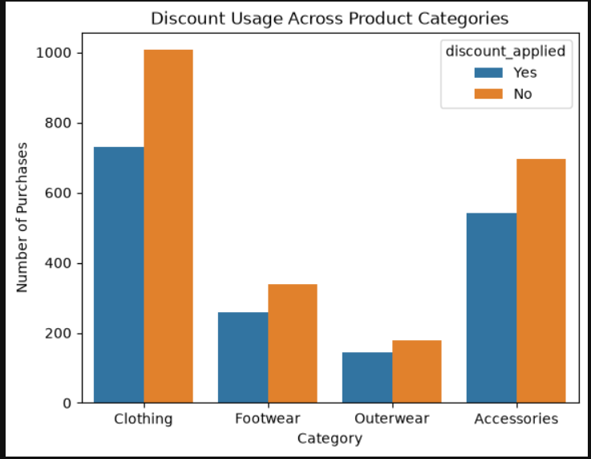
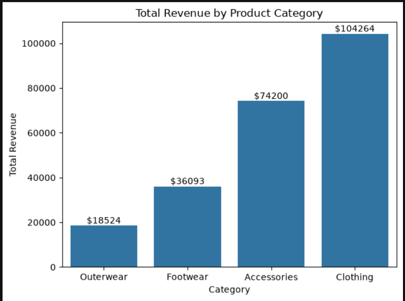
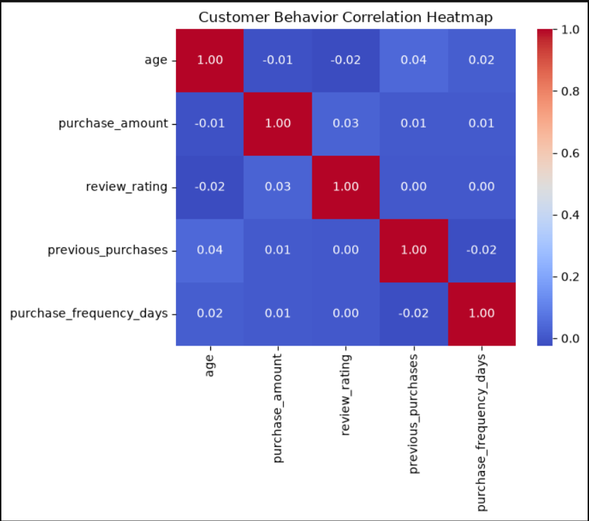
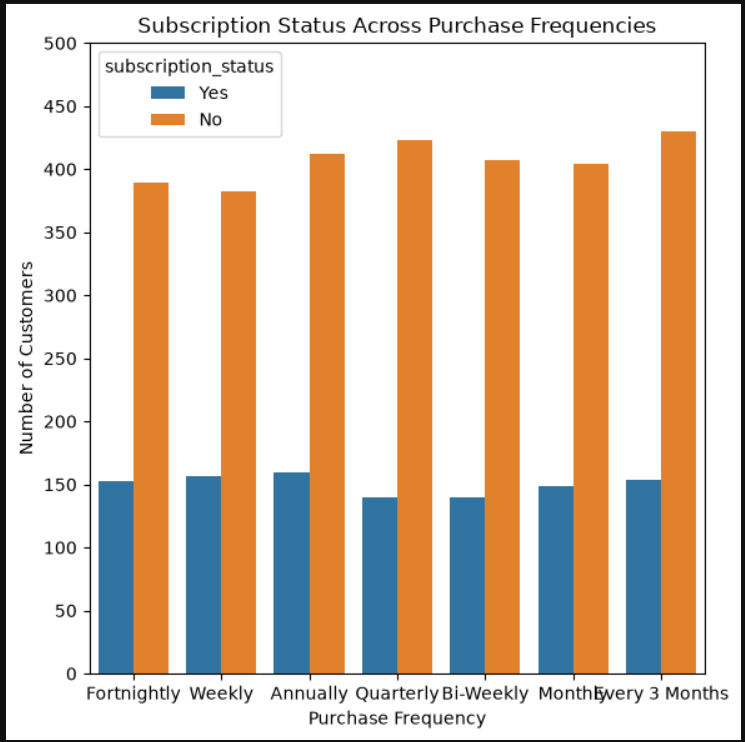
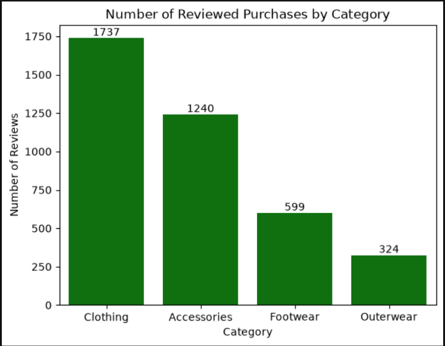

# Customer Shopping Behavior Analysis

## Overview

This project analyzes customer shopping behavior to identify purchasing patterns, revenue trends, product performance, discount usage, and subscription behavior.

The project includes data preprocessing and visualization using Python, along with business-oriented SQL analysis using PostgreSQL.

## Tools & Technologies

- Python
- Pandas
- NumPy
- Matplotlib
- PostgreSQL
- pgAdmin 4
- Jupyter Notebook
- SQL

## Dataset

The dataset contains customer shopping behavior information such as:

- Customer demographics
- Products and categories
- Purchase amounts
- Review ratings
- Subscription status
- Discount usage
- Shipping type
- Previous purchases
- Purchase frequency
- Age groups

## Data Analysis

### Python Analysis & Visualization

The dataset was preprocessed and analyzed using Python in Jupyter Notebook.

The visualizations explore:

- Discount usage across purchasing categories
- Revenue generated by different product categories
- Relationships between numerical customer behavior factors
- Subscription status across different purchase frequencies
- Reviewed purchases across product categories

### SQL Analysis

PostgreSQL was used to answer business-oriented questions, including:

- Revenue generated by male and female customers
- Customers who used discounts while spending above the average purchase amount
- Products with the highest average review ratings
- Average purchase amounts for Standard and Express shipping
- Spending and revenue comparison between subscribed and non-subscribed customers
- Products with the highest percentage of discounted purchases
- Customer segmentation into New, Returning, and Loyal customers
- Top 3 most purchased products within each category
- Subscription status of repeat buyers
- Revenue contribution by age group

## Customer Segmentation

Customers were segmented based on their previous purchases:

- **New:** 1 previous purchase
- **Returning:** 2–10 previous purchases
- **Loyal:** More than 10 previous purchases

## Visualizations

### 1. Discount Usage Across Categories



### 2. Revenue by Product Category



### 3. Numerical Customer Behavior Relationships



### 4. Subscription Status Across Purchase Frequencies



### 5. Reviewed Purchases by Product Category



## Project Structure

```text
data-analytics-project/
│
├── README.md
│
├── data/
│   └── customer_shopping_behavior.csv
│
├── notebook/
│   └── customer_behavior.ipynb
│
└── sql/
    └── data_analysis.sql
